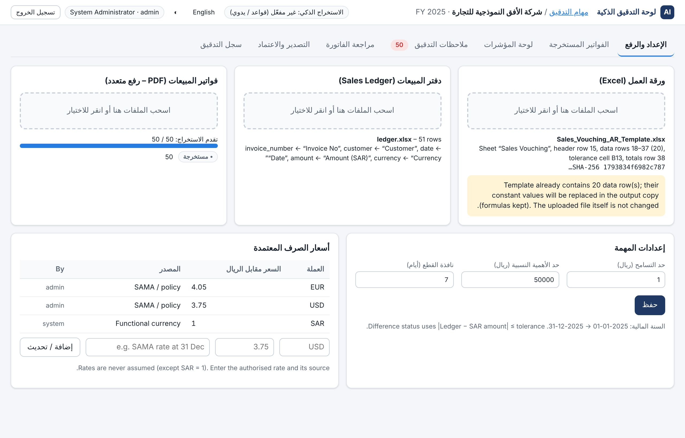
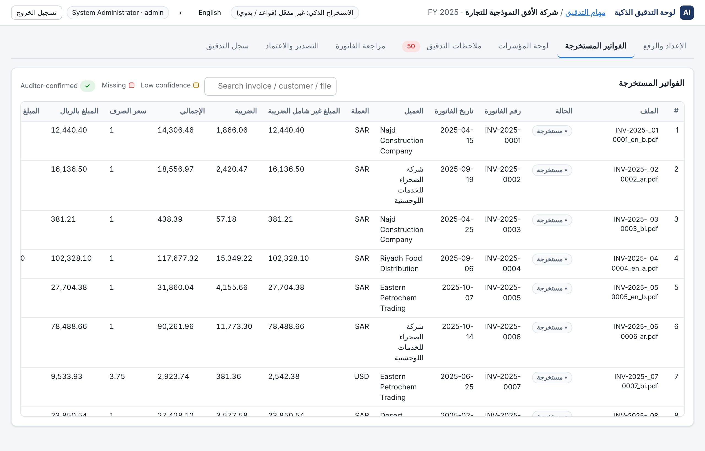
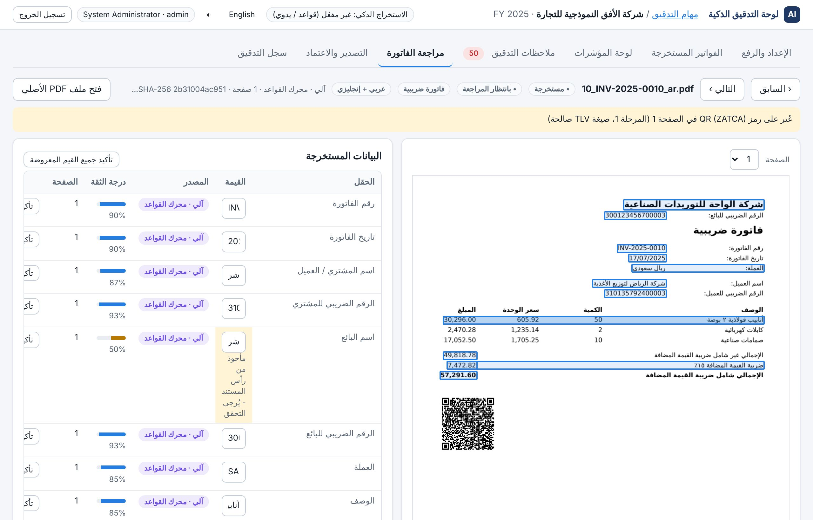
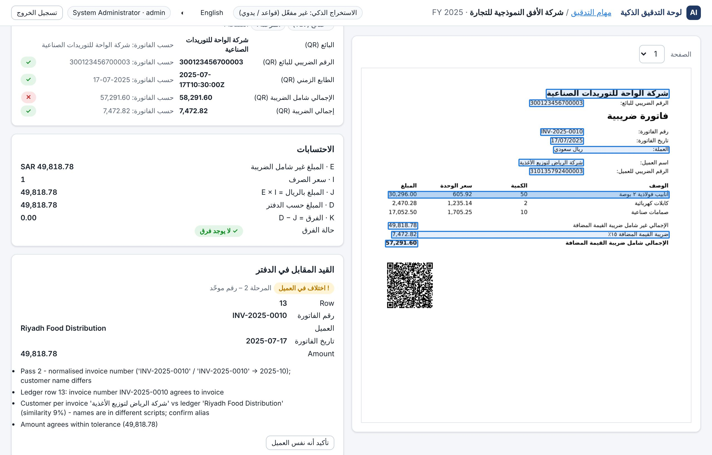
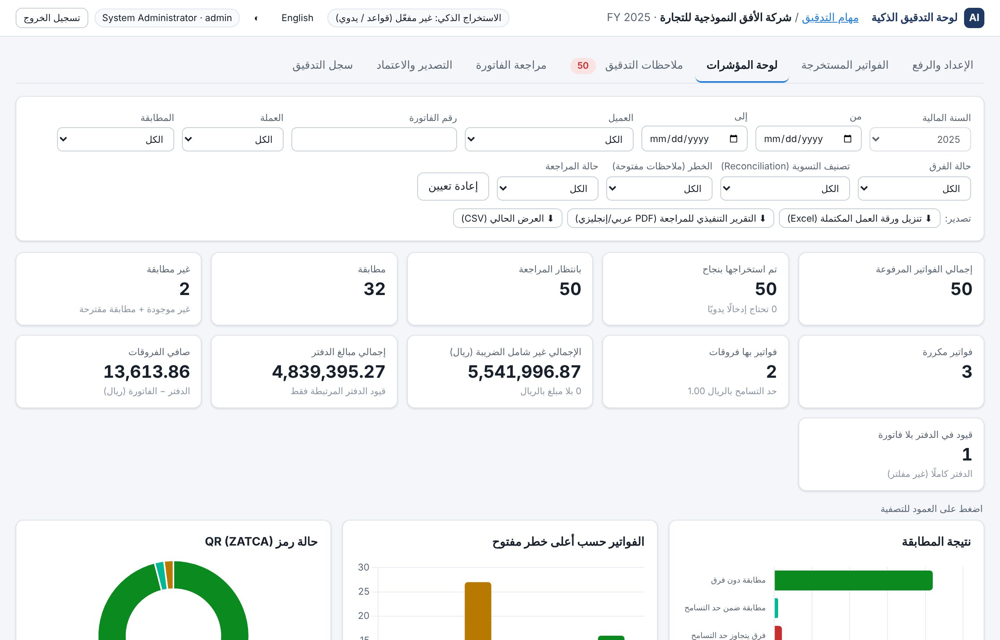
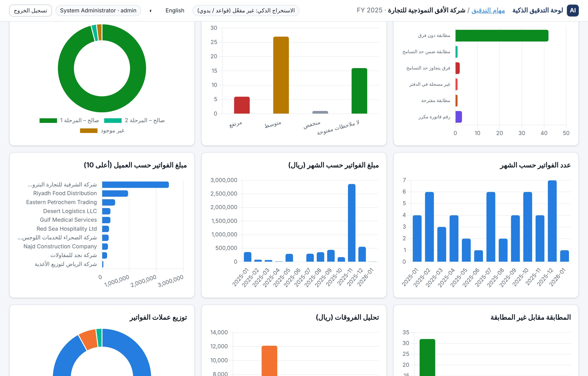
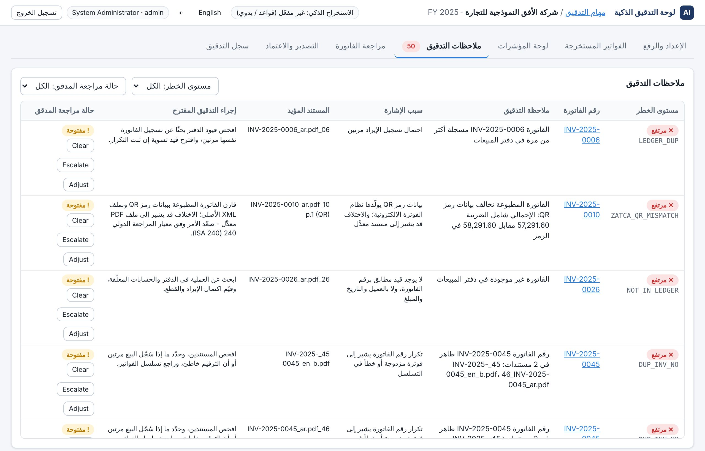
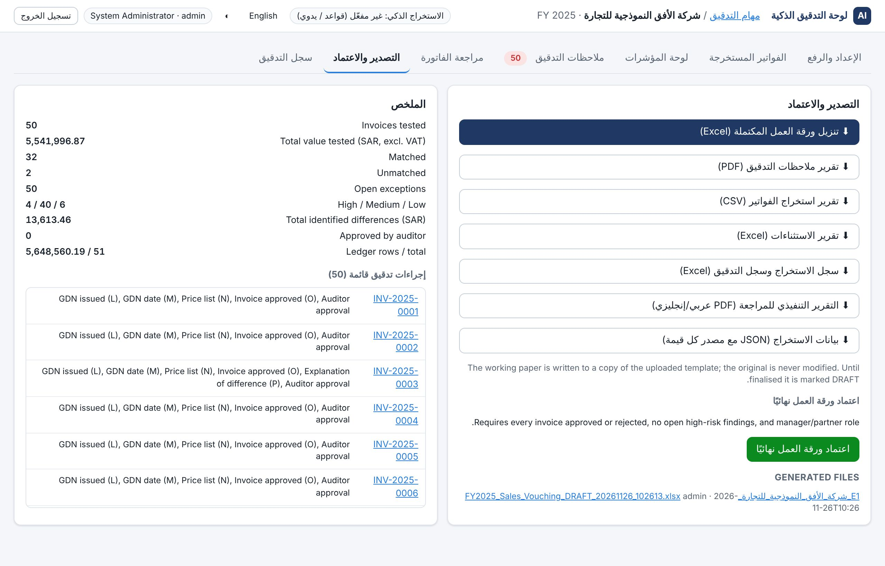

# دليل استخدام لوحة التدقيق الذكية – اختبار المبيعات (Sales Vouching)

**لمن هذا الدليل:** فريق المراجعة (المراجع، المدير، الشريك) الذي يستخدم النظام في اختبار مبيعات العملاء.
**ماذا يفعل النظام:** يقرأ فواتير المبيعات (PDF)، ويطابقها مع دفتر المبيعات، ويُجري فحوص التدقيق، ثم يعبّئ ورقة
العمل الخاصة بالشركة (Excel) دون تغيير معادلاتها أو تنسيقها، ويصدر التقارير. كل رقم يمكن تتبعه إلى صفحته في الفاتورة.

> **مبدأ أساسي:** النظام أداة مساعدة، وليس بديلًا عن حكم المراجع. القيم المستخرجة آليًا تبقى «غير مؤكدة» حتى
> يؤكدها المراجع، والملاحظات ليست استنتاجًا بوجود تحريف، والتقرير التنفيذي لا يتضمن رأيًا مهنيًا.

---

## المحتويات

1. [قبل البدء](#1-قبل-البدء)
2. [إنشاء مهمة تدقيق](#2-إنشاء-مهمة-تدقيق)
3. [رفع الملفات وأسعار الصرف](#3-رفع-الملفات-وأسعار-الصرف)
4. [الفواتير المستخرجة](#4-الفواتير-المستخرجة)
5. [مراجعة الفاتورة](#5-مراجعة-الفاتورة)
6. [لوحة المؤشرات](#6-لوحة-المؤشرات)
7. [ملاحظات التدقيق](#7-ملاحظات-التدقيق)
8. [التصدير والاعتماد النهائي](#8-التصدير-والاعتماد-النهائي)
9. [قواعد يلتزم بها النظام](#9-قواعد-يلتزم-بها-النظام)
10. [مرجع سريع: التصنيفات والملاحظات](#10-مرجع-سريع-التصنيفات-والملاحظات)
11. [أسئلة شائعة وحدود معروفة](#11-أسئلة-شائعة-وحدود-معروفة)

---

## 1. قبل البدء

**التشغيل** (يقوم به مسؤول النظام مرة واحدة):

```bash
pip install -r requirements.txt
```

```bash
AUDIT_ADMIN_PASSWORD='Choose-A-Strong-Password' python -m uvicorn audit_app.api:app --port 8000
```

ثم افتح `http://localhost:8000` وسجّل الدخول. لقراءة الفواتير الممسوحة ضوئيًا دون إنترنت ثبّت أيضًا برنامج
Tesseract بالعربية والإنجليزية (`apt-get install tesseract-ocr tesseract-ocr-ara`).

**اللغة:** زر «English / العربية» أعلى الصفحة يبدّل الواجهة كلها، والواجهة العربية من اليمين إلى اليسار.

**الأدوار والصلاحيات:**

| الدور | ما يستطيع فعله |
|---|---|
| مشاهد (viewer) | الاطلاع على كل شيء دون تعديل |
| مراجع (auditor) | رفع الملفات، تعديل القيم وتأكيدها، إدخال أدلة الأعمدة L–P، تأكيد المطابقات، اعتماد الفواتير |
| مدير / شريك (manager / partner) | ما سبق + حد التسامح، الأهمية النسبية، أسعار الصرف، الاعتماد النهائي وإعادة الفتح |
| مسؤول (admin) | ما سبق + إدارة المستخدمين |

> **تنبيه حماية البيانات:** إذا فُعّل الاستخراج بالذكاء الاصطناعي (مفتاح `ANTHROPIC_API_KEY`) تُرسل ملفات الفواتير
> إلى خدمة Anthropic. تأكد أن شروط الارتباط مع العميل تسمح بذلك، وإلا شغّل النظام بوضع `AUDIT_EXTRACTION_MODE=rules_only`.

---

## 2. إنشاء مهمة تدقيق

من الصفحة الرئيسية اختر **«مهمة جديدة»** وأدخل:

| الحقل | الوصف |
|---|---|
| اسم العميل | يظهر في ورقة العمل وأسماء الملفات المصدّرة (يُحفظ بالعربية) |
| السنة المالية، وبدايتها ونهايتها | تُستخدم في فحص الفترة والقطع |
| حد التسامح (ريال) | الافتراضي 1.00. الفرق ضمنه يُصنّف «مطابقة ضمن حد التسامح» |
| حد الأهمية النسبية (ريال) | يحدد درجة خطر ملاحظة الفروقات |
| نافذة القطع (أيام) | الفواتير القريبة من نهاية السنة بهذا العدد تُطلب لها أدلة التسليم |

---

## 3. رفع الملفات وأسعار الصرف



في تبويب **«الإعداد والرفع»** ثلاث مناطق رفع (اسحب الملفات أو انقر للاختيار):

1. **ورقة العمل (Excel):** قالب الشركة. يتعرف النظام على ورقة «Sales Vouching» وصف العناوين بالعربية أو
   الإنجليزية، ويعرض ما وجده: صف العناوين، صفوف البيانات، خلية حد التسامح، صف الإجماليات. **الملف المرفوع لا
   يُعدَّل أبدًا**؛ التصدير يكون على نسخة منه.
2. **دفتر المبيعات (Excel أو CSV):** تُكتشف الأعمدة تلقائيًا (رقم الفاتورة، العميل، التاريخ، المبلغ، العملة)،
   ويظهر ربط كل عمود تحت اسم الملف. راجع الربط قبل المتابعة.
3. **فواتير المبيعات (PDF، رفع متعدد):** يمكن رفع عشرات الفواتير دفعة واحدة. يُرفض أي ملف ليس PDF حقيقيًا،
   ويُحفظ لكل ملف بصمته الرقمية (SHA-256). يظهر شريط تقدم الاستخراج.

**أسعار الصرف:** النظام **لا يفترض أي سعر صرف** عدا الريال = 1. أدخل لكل عملة أجنبية السعر المعتمد ومصدره
(مثل سعر البنك المركزي السعودي SAMA في تاريخ معيّن). إلى أن يُدخل السعر، لا يُحسب المبلغ بالريال ولا الفرق، وتظهر
ملاحظة «لم يُدخل سعر صرف معتمد».

---

## 4. الفواتير المستخرجة



جدول بكل الفواتير وقيمها المستخرجة: رقم الفاتورة، التاريخ، العميل، المبلغ غير شامل الضريبة، المبلغ بالريال،
مبلغ الدفتر، الفرق، حالة المطابقة، درجة الثقة، حالة المراجعة.

- **خلية فارغة بإطار أحمر:** قيمة لم تُستخرج (لا يخمّن النظام أي قيمة).
- **خلية مظللة بالأصفر:** قيمة درجة ثقتها أقل من 85%، وتحتاج تأكيدًا.
- **طريقة الاستخراج:** محرك القواعد للفواتير النصية، OCR للفواتير الممسوحة، Claude إذا كان مفعّلًا.

اضغط أي صف لفتح الفاتورة في شاشة المراجعة.

---

## 5. مراجعة الفاتورة



الشاشة مقسومة: **صورة الفاتورة** في جهة، و**البيانات** في الجهة الأخرى. عند الضغط على أي حقل يُظلَّل موضعه في
صورة الفاتورة، فترى مصدر القيمة مباشرة.

**الحقول المستخرجة:** لكل حقل قيمته، ومصدره (آلي أو المراجع)، ودرجة الثقة، ورقم الصفحة.
- **«تأكيد»** بجانب الحقل: يعني أنك طابقت القيمة مع المستند.
- **تعديل القيمة:** اكتب القيمة الصحيحة. يُطلب **سبب** التعديل، ويُحفظ في سجل التدقيق مع القيمة الأصلية التي
  استخرجها النظام (لا تُحذف).
- **«تأكيد جميع القيم المعروضة»:** بعد مطابقتها كلها مع المستند.

**الاحتسابات:** E المبلغ غير شامل الضريبة، I سعر الصرف، J = E × I، D مبلغ الدفتر، K = D − J، وحالة الفرق.

**رمز QR (ZATCA):**



يقرأ النظام رمز QR على الفاتورة ويقارن ما فيه (الرقم الضريبي للبائع، التاريخ، الإجمالي، الضريبة) بالمطبوع.
علامة ✕ تعني اختلافًا قد يشير إلى فاتورة معدّلة (في المثال: الإجمالي في الرمز 58,291.60 والمطبوع 57,291.60).
بيانات الرمز **دليل للمقارنة فقط** ولا تُكتب في ورقة العمل. التوقيع الرقمي للمرحلة الثانية لا يتحقق منه النظام.

**القيد المقابل في الدفتر:** يظهر القيد المرتبط، ومرحلة المطابقة، وأسباب الربط.
- **المطابقة المقترحة (المرحلة 3):** لا تُربط تلقائيًا أبدًا. راجع المرشحين واضغط «تأكيد المطابقة» مع ذكر الدليل،
  أو «رفض الكل».
- **«تأكيد أنه نفس العميل»:** عند اختلاف اسم العميل بين الفاتورة والدفتر لنفس الجهة (مثل اسم عربي واسم إنجليزي)؛
  يُطبّق على كل فواتير هذا العميل.

**أدلة المراجع (الأعمدة L–P):** إشعار التسليم (نعم/لا/لا ينطبق)، تاريخ التسليم، مطابقة السعر لقائمة الأسعار،
اعتماد الفاتورة، وتفسير الفرق. هذه الأعمدة **لا يملؤها إلا المراجع**. للفرق اقتراح تفسير آلي (مثل «يبدو أن مبلغ
الدفتر يشمل الضريبة»)؛ زر «استخدام كتفسير» ينسخه إلى خانة التفسير لتراجعه ثم تحفظه.

**حالة المراجعة:**
- **«اعتماد»:** يتطلب تأكيد الحقول الأساسية الخمسة (الرقم، التاريخ، العميل، المبلغ غير شامل الضريبة، العملة). وإذا بقيت
  على الفاتورة ملاحظة مفتوحة عالية الخطورة، يلزم إقفالها أو كتابة تعليق يبرر الاعتماد.
- **«تحقق إضافي»** و**«رفض»:** يتطلبان تعليقًا.

---

## 6. لوحة المؤشرات



**الفلاتر:** التاريخ، العميل، رقم الفاتورة، العملة، حالة المطابقة، حالة الفرق، تصنيف المطابقة، **الخطر**، حالة
المراجعة. كل المؤشرات والرسوم والجدول تتحدث فورًا مع الفلاتر، وكلها محسوبة من الصفوف نفسها التي تُكتب في ورقة العمل.

**المؤشرات (11):** إجمالي الفواتير، المستخرجة، بانتظار المراجعة، المطابقة، غير المطابقة، المكررة، التي بها فروقات،
الإجمالي بالريال، إجمالي الدفتر، صافي الفروقات، وقيود الدفتر بلا فاتورة (للدفتر كاملًا).



**الرسوم (10):** نتيجة المطابقة، الفواتير حسب أعلى خطر، حالة رمز QR، العدد والمبلغ حسب الشهر، المبلغ حسب العميل،
المطابقة، تحليل الفروقات، العملات، درجات الثقة.

**التصفية بالضغط:** اضغط أي عمود في رسوم «نتيجة المطابقة» أو «الخطر» أو «المطابقة» لتصفية اللوحة كلها على تلك الفئة.

**التصدير من اللوحة:** ورقة العمل، التقرير التنفيذي، و**«العرض الحالي (CSV)»** الذي يصدّر الصفوف الظاهرة بعد
التصفية فقط، بعناوين بلغة الواجهة ويفتح في Excel بالعربية سليمة.

---

## 7. ملاحظات التدقيق



لكل ملاحظة: درجة الخطر (مرتفع/متوسط/منخفض)، الفاتورة، الملاحظة، سبب الإبلاغ، المستند المؤيد (مع رقم الصفحة)،
الإجراء المقترح، وحالة المراجعة. عدد الملاحظات المفتوحة يظهر على التبويب.

**حالات الملاحظة:** مفتوحة، مُقفلة (تتطلب **ملاحظة المراجع**)، مُصعَّدة، قيد تسوية مقترح.

الملاحظات تُحدَّث تلقائيًا بعد كل تعديل؛ إذا زال سببها (مثلًا أُدخل سعر الصرف) تختفي من القائمة النشطة، ويبقى أثرها
في سجل التدقيق.

---

## 8. التصدير والاعتماد النهائي



| الملف | المحتوى |
|---|---|
| ورقة العمل المكتملة (Excel) | نسخة من قالب الشركة معبّأة. المعادلات (J وK وعمود الحالة P) كما هي، والصفوف الإضافية تُدرج مع تحديث كل المراجع والإجماليات. تُضاف ورقتان: «AI Audit Summary» (ملخص التدقيق والتنبيهات) و«AI Extraction Log» (سجل الاستخراج)، ولا تُغيَّر أي ورقة موجودة. القيم غير المؤكدة عليها تعليق خلية بالطريقة والثقة والصفحة |
| تقرير ملاحظات التدقيق (PDF) | كل الملاحظات مرتبة حسب الخطر |
| التقرير التنفيذي (PDF عربي/إنجليزي) | للشريك والعميل: النطاق والتغطية، نتائج المطابقة، الملاحظات حسب الخطر، الفروقات، رموز QR، الإجراءات المتبقية. خانة **استنتاج فريق المراجعة فارغة** ليكتبها الفريق |
| تقرير استخراج الفواتير (CSV) | كل الصفوف وحالاتها |
| تقرير الاستثناءات (Excel) | الاستثناءات فقط |
| سجل الاستخراج وسجل التدقيق (Excel) | كل قيمة ومصدرها، وكل تعديل ومن قام به ومتى |
| بيانات الاستخراج (JSON) | بالصيغة الواردة في المواصفات، مع مصدر كل قيمة |

**المسودة والاعتماد:** كل ما يُصدَّر قبل الاعتماد يحمل علامة «مسودة». **الاعتماد النهائي** (للمدير أو الشريك) يتطلب
أن تكون كل الفواتير معتمدة أو مرفوضة، وألا تبقى ملاحظة مفتوحة عالية الخطورة. بعد الاعتماد تُقفل المهمة، وإعادة
فتحها تتطلب سببًا يُسجَّل.

---

## 9. قواعد يلتزم بها النظام

1. **لا تخمين:** أي قيمة لم تُقرأ بثقة تبقى فارغة وتظهر لها ملاحظة. مبلغ الدفتر (D) يبقى فارغًا ما لم يُربط قيد فعلي.
2. **المبلغ الصافي:** العمود E هو المبلغ **غير شامل** ضريبة القيمة المضافة. إذا كان (الخاضع + الضريبة − الإجمالي)
   أكبر من 0.05 ريال تظهر ملاحظة «خطأ حسابي في الفاتورة».
3. **المعادلات محفوظة:** لا تُستبدل أي معادلة في القالب بقيمة ثابتة.
4. **المطابقة على ثلاث مراحل:** (1) تطابق تام للرقم والعميل، (2) الرقم بعد التوحيد (حذف INV- و TAX- و# والأصفار
   البادئة)، (3) اقتراح بالعميل (تشابه أكثر من 85%) والتاريخ (±5 أيام عمل) والمبلغ (ضمن حد التسامح) — والمرحلة
   الثالثة **اقتراح فقط** يؤكده المراجع.
5. **رمز QR دليل فقط:** يُقارن ولا يملأ الحقول.
6. **التاريخ الهجري:** يُحوَّل إلى الميلادي بتقويم أم القرى، لكنه يبقى منخفض الثقة (60%) مع ملاحظة «تاريخ هجري» حتى
   يؤكده المراجع.
7. **الفواتير الممسوحة (OCR):** ثقة كل حقل لا تتجاوز ثقة القراءة، وتظهر ملاحظة «قُرئت الفاتورة بتقنية OCR» حتى تُطابق
   القيم الأساسية مع الصورة (الصورة الممسوحة دليل أقل موثوقية — معيار المراجعة الدولي 500).
8. **السجل الإنجليزي مرجعي:** نصوص الملاحظات تُحفظ بالإنجليزية في سجل التدقيق، وتُعرض بالعربية في الواجهة العربية.

---

## 10. مرجع سريع: التصنيفات والملاحظات

**تصنيف نتيجة المطابقة:**

| التصنيف | المعنى | ما يفعله المراجع |
|---|---|---|
| مطابقة دون فرق | الفاتورة مسجلة والفرق صفر | استكمال أدلة L–O والاعتماد |
| مطابقة ضمن حد التسامح | فرق لا يتجاوز حد التسامح | كما سبق |
| فرق يتجاوز حد التسامح | فرق جوهري بين الدفتر والفاتورة | الحصول على تفسير وتسوية مؤيدة، وكتابة التفسير في P |
| غير مسجلة في الدفتر | فاتورة بلا قيد (خطر الاكتمال والقطع) | البحث في الدفتر والحسابات المعلقة |
| مطابقة مقترحة | قيد محتمل بلا رقم مطابق | تأكيد المطابقة أو رفضها |
| رقم فاتورة مكرر | الرقم في أكثر من مستند أو قيد | فحص المستندين وتسلسل الفواتير |
| بيانات ناقصة | مثل سعر صرف غير مدخل | إكمال البيانات |
| قيد في الدفتر بلا فاتورة | مبيعات مسجلة بلا مستند (خطر الحدوث) | طلب الفاتورة المؤيدة |

**أهم الملاحظات:**

| الملاحظة | الخطر | متى تظهر |
|---|---|---|
| الفاتورة المطبوعة تخالف رمز QR | مرتفع | اختلاف بين المطبوع وبيانات الرمز |
| الفاتورة غير موجودة في الدفتر | مرتفع | لا قيد مطابق |
| قيد في الدفتر بلا فاتورة | مرتفع/متوسط | حسب الأهمية النسبية |
| فرق بين الدفتر والفاتورة | مرتفع/متوسط | حسب الأهمية النسبية |
| تاريخ الفاتورة خارج السنة المالية | مرتفع | فترة وقطع |
| اختلاف في العميل | متوسط | اسم العميل مختلف بين الفاتورة والدفتر |
| درجة ثقة منخفضة | متوسط | حقل أساسي أقل من 85% |
| خطر القطع | متوسط | فاتورة قريبة من نهاية السنة بلا تاريخ تسليم |
| قُرئت بتقنية OCR / تاريخ هجري | منخفض | تحتاج تأكيد المراجع |

---

## 11. أسئلة شائعة وحدود معروفة

**لماذا بقيت قيمة فارغة؟** لأن النظام لم يقرأها بثقة كافية؛ أدخلها يدويًا من المستند (مع ذكر السبب).

**لماذا لم يحسب المبلغ بالريال لفاتورة بالدولار؟** أدخل سعر الصرف المعتمد ومصدره في «الإعداد والرفع».

**هل يغيّر النظام ملف القالب الأصلي؟** لا. التصدير دائمًا على نسخة، والأصل محفوظ ببصمته الرقمية.

**هل يمكن الاعتماد على OCR وحده؟** لا. القيم المقروءة بالـ OCR تُطابق مع صورة الفاتورة قبل الاعتماد، وقد يخطئ في
بعض الأحرف (مثلًا قُرئت «SAR» على أنها «8» في بعض الفواتير الممسوحة، فتُركت العملة فارغة مع ملاحظة).

**حدود معروفة:**
- قيست دقة الاستخراج على فواتير نموذجية؛ الفواتير الحقيقية (أختام، كتابة يدوية، جودة مسح) قد تختلف، فيجب قياسها على
  عينة فعلية قبل الاعتماد.
- لا يتحقق النظام من التوقيع الرقمي لرمز QR في المرحلة الثانية.
- بعض الرسائل الفنية ما زالت بالإنجليزية (مثل تنبيهات فحص القالب، وأسطر أسباب المطابقة).
- تقرير ملاحظات التدقيق (PDF) وتقرير الاستثناءات بالإنجليزية؛ التقرير التنفيذي بالعربية والإنجليزية.
